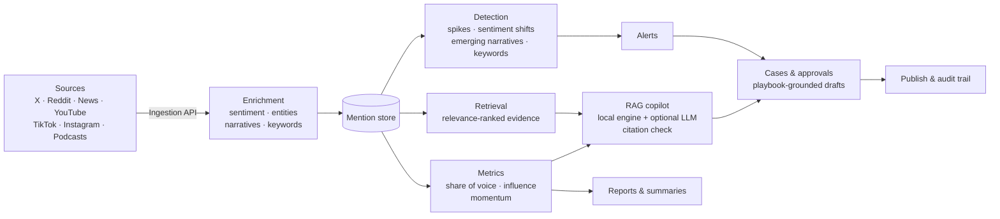

<div align="center">


# MediaGPT: AI-Powered Media Intelligence Copilot

**Turn a flood of news and social coverage into summaries, insights and answers you can trace back to the source.**

MediaGPT is an AI **media intelligence copilot**. It monitors news and social mentions, **summarizes** coverage, extracts **actionable insights**, runs explainable **sentiment analysis**, supports **semantic-style search**, and answers plain-English questions through a **RAG (retrieval-augmented generation)** copilot. Every answer cites the mentions it came from. It is built with Node.js and an optional LLM (Claude) layer.

[](https://nodejs.org)
[](package.json)
[](tests)
[](LICENSE)
[](#how-the-rag-copilot-works)

[Quick start](#quick-start) · [Features](#features) · [Screenshots](#screenshots) · [Demo walkthrough](#5-minute-guided-demo) · [REST API](#rest-api) · [Architecture](#architecture) · [FAQ](#faq)

<br/>


</div>

---

## Table of contents

- [Why MediaGPT?](#why-mediagpt)
- [Features](#features)
- [How the RAG copilot works](#how-the-rag-copilot-works)
- [Screenshots](#screenshots)
- [Quick start](#quick-start)
- [Configuration](#configuration)
- [Enable the LLM (optional)](#enable-the-llm-optional)
- [The demo story](#the-demo-story)
- [5-minute guided demo](#5-minute-guided-demo)
- [Use cases](#use-cases)
- [REST API](#rest-api)
- [Architecture](#architecture)
- [Project structure](#project-structure)
- [Testing](#testing)
- [Current scope and roadmap](#current-scope-and-roadmap)
- [FAQ](#faq)
- [Contributing](#contributing)
- [License and attribution](#license-and-attribution)

## Why MediaGPT?

Media and PR teams do not have a shortage of mentions. They have a shortage of time. MediaGPT reads the coverage for you and answers the questions that matter: *what happened, why sentiment changed, who is amplifying it, and what to do next.*

- **Summaries and insights, not just counts.** Executive briefings, daily digests and on-demand answers turn raw mentions into decisions.
- **Grounded generative AI.** The copilot can only cite mentions it retrieved. If an answer cites anything else, it is rejected and the local answer is used instead.
- **Explainable.** Every sentiment score, narrative label and alert shows the evidence behind it.
- **Easy to run.** Zero runtime dependencies. No database, no build step. Clone it and run `npm start`.

## Features

| Capability | What you get |
|---|---|
| 📝 **Text summarization** | Executive briefing, PR intelligence report, newsletter and daily digest generated from the live mention stream, plus on-demand summaries through the copilot ("summarize the last 24 hours") |
| 💡 **Actionable insight extraction** | Main drivers, when and where a spike started, who amplified it, secondary drivers and recommended next steps |
| 💬 **Sentiment analysis** | Explainable lexicon-based NLP with clause-scoped negation, intensity boosters, contrast handling ("but"/"still"), damped questions and domain phrases. Every mention shows *why* it got its score |
| 🔎 **Semantic-style search** | Full-text search with relevance ranking, saved Boolean-style monitoring queries, entity and narrative filters, and a copilot that retrieves the most relevant evidence for a question |
| 🤖 **RAG copilot** | Ask questions in plain English. Answers come with `M-xxxxx` citations, a time window and structured evidence. An LLM can optionally write the prose |
| 🧭 **Narrative intelligence** | Signal-based narrative classification, 72-hour momentum, rising and fading narratives, sparklines and drill-down |
| 🏁 **Competitive intelligence** | Share of voice, net sentiment, coverage, reach and trends for each competitor |
| ⭐ **Influencer analytics** | Impact ranking (reach × engagement × volume), stance detection and author profiles |
| 🚨 **Crisis detection & alerts** | Spike detection (z-score against a 14-day baseline), sentiment shifts, emerging narratives, influencer activity and priority keyword rules |
| ✍️ **Response management** | Cases from alerts, AI-suggested playbook-grounded drafts, approval chains, escalation, publishing and a full timeline |
| 🔐 **Governance** | Role-based access control, segregation of duties, audit trail, optional API key and rate limiting |

## How the RAG copilot works

MediaGPT uses retrieval-augmented generation so that answers are tied to real data instead of model memory.

1. **Retrieve.** The question is classified (why, who, compare, summarize, recommend, search). The engine then pulls the matching time window and ranks the most relevant mentions, narratives, authors and metrics by relevance score.
2. **Ground.** The ranked evidence is packaged into a structured context. Nothing outside it is available to the model.
3. **Generate.** The local engine writes an answer from the evidence. If an LLM key is set, Claude writes the prose from that same evidence.
4. **Verify.** Every cited mention ID is checked against the evidence. If the answer cites anything missing, it is thrown away and the local answer is served. The same happens if the LLM fails or refuses.

> **Note on retrieval:** the current retriever is a local relevance-ranking engine (tokenization, signal matching and scoring). It does not use a vector database or embedding model yet. Embedding-based retrieval is on the [roadmap](#current-scope-and-roadmap).

## Screenshots

### AI copilot: answers with evidence

Ask in plain English. Every claim links to the source mentions, the time window and the people who amplified it.


### Narrative intelligence: see the stories behind the mentions

<table>
<tr>
<td width="50%"></td>
<td width="50%"></td>
</tr>
<tr>
<td align="center"><sub>Narratives ranked by 72-hour momentum</sub></td>
<td align="center"><sub>Drill-down: timeline, playbook, alerts and amplifiers</sub></td>
</tr>
</table>

### Competitive and influencer intelligence

<table>
<tr>
<td width="50%"></td>
<td width="50%"></td>
</tr>
<tr>
<td align="center"><sub>Share of voice and brand benchmark</sub></td>
<td align="center"><sub>Influencers ranked by impact and stance</sub></td>
</tr>
</table>

### Alerts and response approval workflow

<table>
<tr>
<td width="50%"></td>
<td width="50%"></td>
</tr>
<tr>
<td align="center"><sub>Spike, sentiment, influencer and keyword alerts</sub></td>
<td align="center"><sub>AI-drafted response going through approval</sub></td>
</tr>
</table>

## Quick start

**Requirements:** [Node.js](https://nodejs.org) 20 or newer.

```bash
git clone https://github.com/<your-username>/MediaGPT.git
cd MediaGPT
npm start            # → http://localhost:3000
```

```bash
npm run dev          # auto-restart on file changes
npm test             # 33 tests, ~1s
npm run reset        # regenerate the demo workspace
```

The first start generates a 30-day demo workspace in `data/db.json` with about 1,400 mentions. Timestamps are relative to "now", so the dashboards always look live. To start over, delete that file or use **Settings → Reset demo data**.

## Configuration

| Env var | Default | Purpose |
|---|---|---|
| `PORT` | `3000` | HTTP port |
| `MEDIAGPT_DATA` | `data/db.json` | Path to the data file |
| `MEDIAGPT_API_KEY` | (unset) | If set, every non-GET API call needs an `X-API-Key` header |
| `ANTHROPIC_API_KEY` | (unset) | Turns on the LLM for copilot answers and response drafts |
| `MEDIAGPT_MODEL` | `claude-opus-5-5` | The Claude model to use |
| `MEDIAGPT_LLM=off` | (unset) | Use the local engine even when an API key is set |

## Enable the LLM (optional)

MediaGPT works fully offline with its local, explainable engine. To have Claude write copilot answers and response drafts, install the optional SDK and set your key:

```bash
npm install                       # installs the optional @anthropic-ai/sdk
export ANTHROPIC_API_KEY=sk-ant-...
npm start
```

The LLM sees only the retrieved evidence, and its output goes through the citation check described in [How the RAG copilot works](#how-the-rag-copilot-works).

## The demo story

The demo workspace monitors **Halvia Mobile**, a fictional mobile carrier, against three fictional competitors: Telluma, Corvane Wireless and Brisa Connect. All people, handles and outlets are invented.

| When | What happens | What MediaGPT detects |
|---|---|---|
| ~20 days ago | 5G Ultra launch | Positive narrative, creator and press reviews |
| ~11 days ago | $5 legacy-plan price increase | Negative backlash narrative |
| ~60h ago | **Network outage** in the Mountain region | Critical volume spike, sentiment drop, journalist and influencer alerts, legal and public-safety keyword alerts |
| last 72h | Telluma "Switch & Save" campaign | Competitive share-of-voice movement |
| last 5 days | Location-data privacy clause | **Emerging** negative narrative, small but accelerating |

## 5-minute guided demo

1. **Overview**: the KPI cards and volume chart show the outage spike. "Needs attention" lists the critical alerts.
2. **Copilot**: ask *"Why did negative sentiment rise in the last 72 hours?"*. The answer names the driver, when and where it started, who amplified it and the secondary drivers, with `M-xxxxx` chips that open the source posts. Also try *"Give me an executive summary of the last 24 hours"*.
3. **Alerts**: open the *Conversation spike* alert → **Open case** (P1, routed to Network Ops).
4. **Case**: click **✧ Suggest response** (channel `media-statement` or `x`). The draft uses only the narrative's approved playbook facts. Then click **Submit for approval**.
5. Switch user (top right) to **Daniel Ortiz · manager** → Approve. Then **Rebecca Lin · executive** → Approve. Back as **Aisha** → **Publish response**. The timeline and **Settings → Audit trail** record every step.
6. **Narratives → Location data sharing concerns** shows the next issue forming. **Competitors** shows Telluma's share-of-voice jump.
7. **Reports**: executive briefing → *Save as PDF*.

You can also try **⟳ Pull live mentions** (simulated ingestion that re-runs detection), add a monitoring query or alert rule in Settings, or try to approve `CASE-1003` as its submitter. Segregation of duties blocks that approval.

## Use cases

- **PR & corporate communications**: spot a crisis early, understand what drives it, and publish an approved statement quickly.
- **Newsrooms & media analysts**: summarize large volumes of coverage and pull out the key takeaways.
- **Brand & marketing teams**: track brand health, campaign reception and share of voice against competitors.
- **Risk, legal & compliance**: get alerts on legal, regulatory, security and public-safety keywords, with a full audit trail.
- **Developers & data teams**: use the REST API as a reference design for NLP enrichment, anomaly detection and grounded LLM features.

## REST API

All routes live under `/api/v1`. Set the acting user with the `X-MediaGPT-User` header (`u-aisha`, `u-daniel`, `u-rebecca` or `u-admin`). The default user is the analyst.

| Method & path | Purpose |
|---|---|
| `GET /health`, `GET /meta` | Status, workspace metadata, users and permissions |
| `GET /overview?days=7&entity=halvia` | Dashboard KPIs, series, share of voice, narratives and influencers |
| `GET /mentions?q=&entity=&source=&sentiment=&narrative=&query=&days=&sort=&limit=&offset=` | Mention search |
| `POST /mentions` | Ingest one mention, an array, or `{mentions: [...]}`. Mentions are enriched, then detection re-runs |
| `POST /mentions/simulate` | Simulate a burst of live mentions |
| `GET /mentions/:id` | One mention with its AI explanation |
| `GET /narratives`, `GET /narratives/:id` | Narrative intelligence |
| `GET /competitors`, `GET /influencers`, `GET /authors/:id` | Competitive and influencer intelligence |
| `GET /alerts`, `GET /alerts/:id`, `POST /alerts/:id/triage`, `POST /alerts/:id/case` | Detection and triage |
| `POST /copilot` `{question}` | RAG copilot |
| `GET/POST /cases`, `GET/PATCH /cases/:id` | Cases |
| `POST /cases/:id/draft/suggest`, `PUT /cases/:id/draft` | AI-suggested or manually edited draft |
| `POST /cases/:id/submit`, `/decision` `{decision, note}`, `/publish`, `/escalate`, `/resolve` | Approval workflow |
| `GET /reports/:type` and `/reports/:type.html` (`brief`, `pr`, `newsletter`, `digest`) | Reports as JSON or printable HTML |
| `GET /export/mentions.csv` | CSV export |
| `GET/POST /queries`, `DELETE /queries/:id`, `GET/POST /rules`, `PATCH /settings`, `GET /audit`, `POST /admin/reset` | Configuration and governance |

**Example: ingest a mention and trigger an alert**

```bash
curl -X POST localhost:3000/api/v1/mentions -H 'content-type: application/json' \
  -d '{"text":"Was Halvia hacked? My data got leaked","source":"reddit","author":"u/someone","followers":120}'
# → enriched mention + a new "Security and data incident" alert
```

**Example: ask the copilot**

```bash
curl -X POST localhost:3000/api/v1/copilot -H 'content-type: application/json' \
  -d '{"question":"Why did negative sentiment rise in the last 72 hours?"}'
```

## Architecture



## Project structure

```
server.js          HTTP server: API + static SPA, minute-by-minute detection refresh
src/seed.js        Fictional brands, narratives (signals, playbooks), authors, 30-day storyline
src/nlp.js         Sentiment, entity detection, narrative classification, queries, keywords, relevance
src/metrics.js     Volume series, share of voice, narrative stats, influence ranking, breakdowns
src/detect.js      Spike / sentiment / emerging / influencer / competitive / keyword detection
src/copilot.js     RAG copilot (evidence retrieval, answer generation, citation verification)
src/respond.js     Playbook-grounded response suggestions
src/reports.js     Executive briefing, PR intelligence, newsletter, digest, printable HTML
src/llm.js         Optional Claude client (dynamic import of @anthropic-ai/sdk)
src/service.js     Store, enrichment pipeline, case workflow, RBAC, audit, persistence
src/api.js         REST routes, auth header, API key, rate limiting
public/            Vanilla-JS single-page app + dependency-free SVG charts
tests/             node:test suites (NLP, detection, copilot, service, API)
```

**Tech stack:** Node.js (ES modules, built-in `http` and `node:test`), vanilla JavaScript front end, hand-built SVG charts, JSON file storage and the optional Anthropic Claude SDK.

## Testing

```bash
npm test
```

33 tests cover sentiment and NLP edge cases, the detection algorithms, copilot grounding and citation checks, the case workflow and RBAC, persistence and the REST API. They run in about one second with no network access.

## Current scope and roadmap

| Area | Today | Next |
|---|---|---|
| Data sources | Seeded storyline, ingestion API and a simulated live feed | News and social API connectors, RSS and webhooks |
| Retrieval | Local relevance ranking over mentions, narratives and authors | Embedding-based semantic search with a vector store |
| NLP | Explainable lexicon and signal models, English only | Transformer-based sentiment, multilingual support |
| Summarization | Template and evidence-based briefings, optional LLM prose | Per-article LLM summaries with source links |
| Identity | User switcher and RBAC | SSO (SAML/OIDC) |
| Storage | JSON file | Database and search index |

## FAQ

**What is MediaGPT?**
An AI copilot for media intelligence. It reads news and social coverage, summarizes it, scores sentiment, finds the narratives and answers questions with citations.

**Is it a RAG system?**
Yes. Answers are built from evidence retrieved from the mention store, and every citation is verified. Retrieval is currently relevance-ranked rather than vector-based. See [How the RAG copilot works](#how-the-rag-copilot-works).

**Do I need an AI API key?**
No. Every feature works offline with the local engine. Setting `ANTHROPIC_API_KEY` only improves the wording of copilot answers and response drafts.

**Can I connect real data?**
Yes. Send mentions from any source (news APIs, social APIs, RSS, webhooks) to `POST /api/v1/mentions`. Each one is enriched and run through detection right away.

## Contributing

Contributions are welcome: bug reports, feature ideas, data connectors, NLP improvements and documentation fixes.

1. Fork the repository and create a branch: `git checkout -b feature/my-change`
2. Make your change and add tests where they make sense
3. Run `npm test` and make sure every test passes
4. Open a pull request that describes what you changed and why

If MediaGPT is useful to you, please **⭐ star the repo**.

## License and attribution

[MIT](LICENSE). MediaGPT is derived from the MIT-licensed [Narravyn MVP](https://github.com/SDLC-corp/Narravyn-AI-MVP) by SDLC Corp, and the original copyright notice is kept in the LICENSE file as the license requires.

---

<div align="center">

<sub>Keywords: media intelligence, AI copilot, RAG, LLM, generative AI, text summarization, sentiment analysis, semantic search, media monitoring, narrative intelligence, news analysis, Claude, NLP, Node.js</sub>

</div>
# MediaGPT

